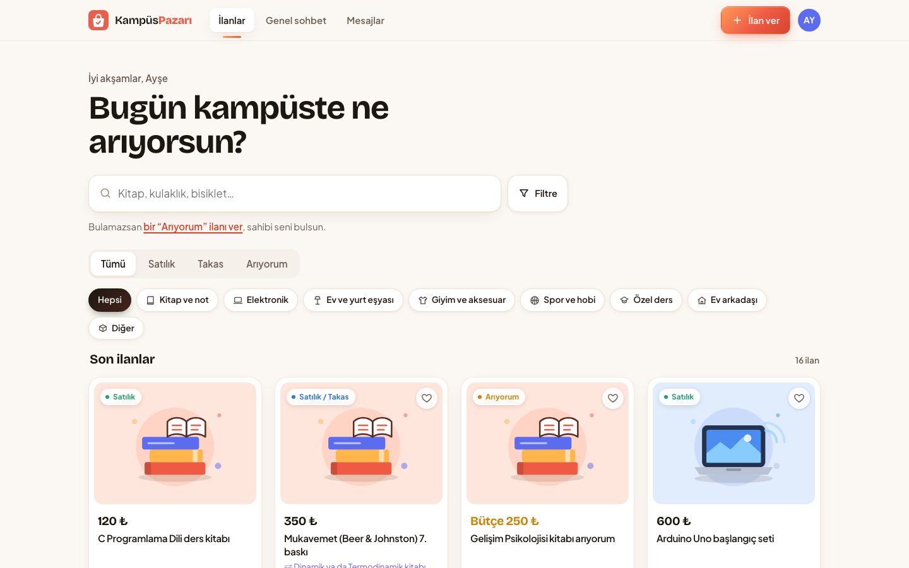
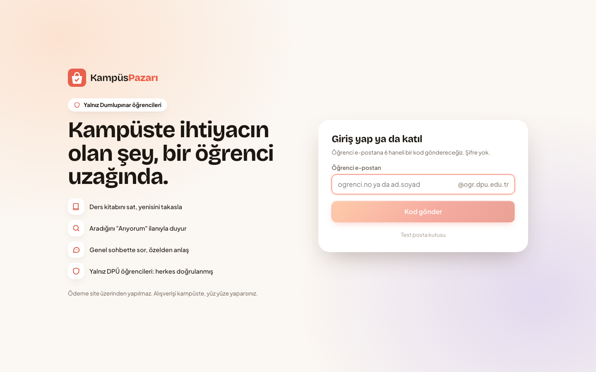
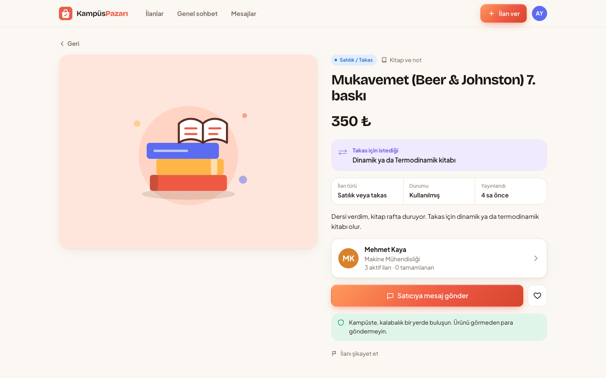
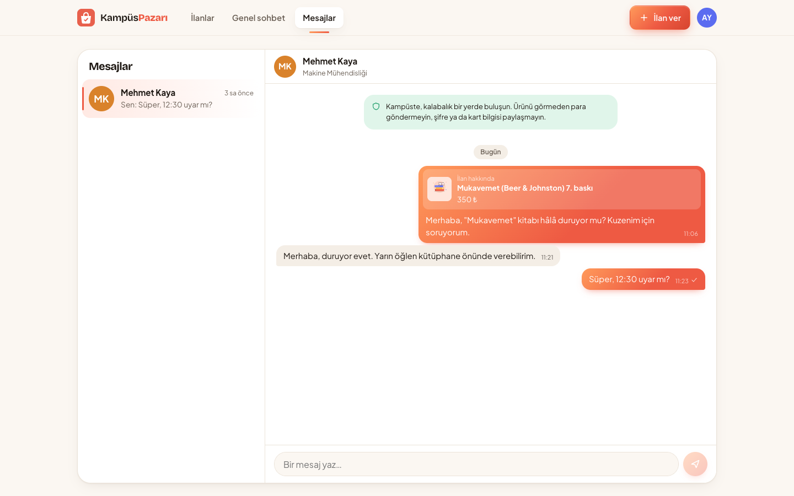
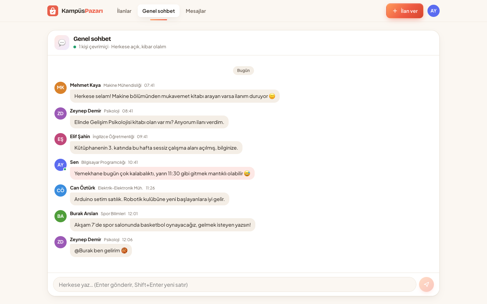
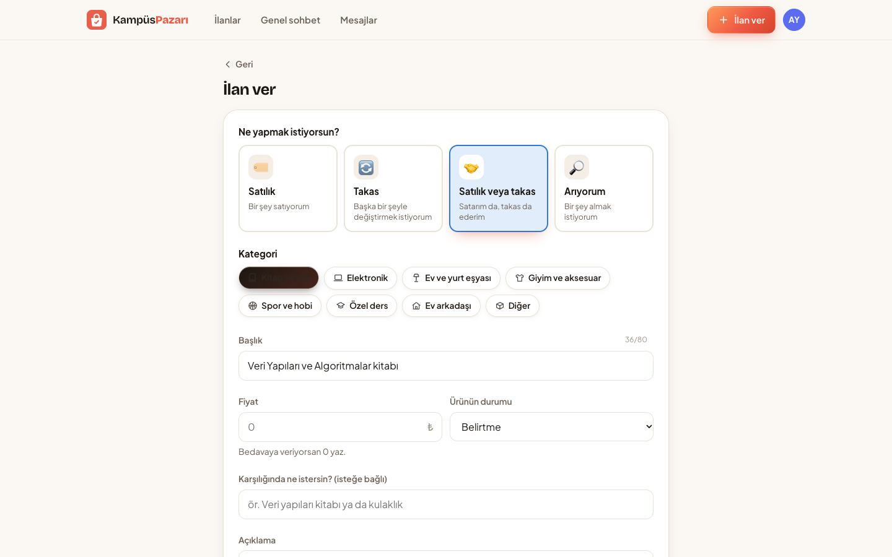
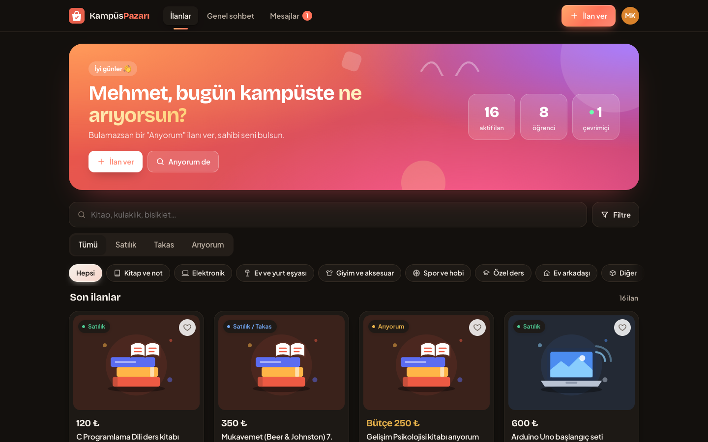
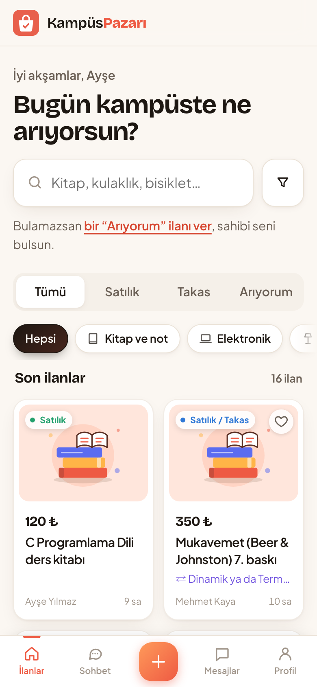
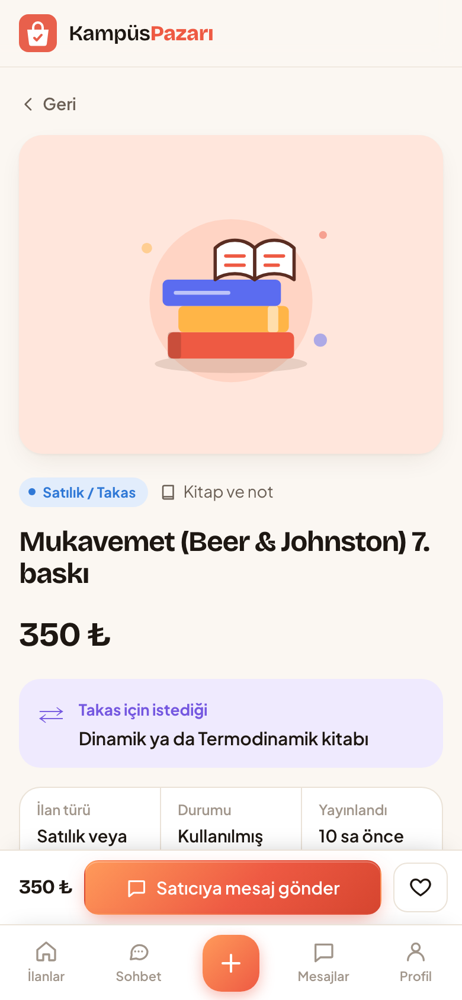
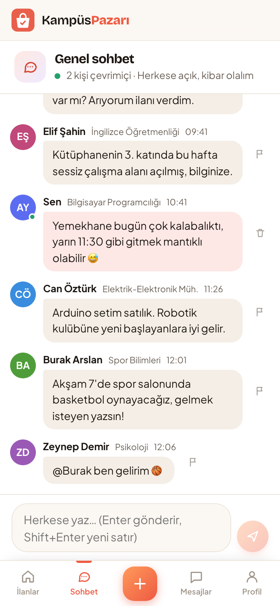

**English** · [Türkçe](README.tr.md)

# Kampüs Pazarı: a student-only campus marketplace

A buy, sell and swap marketplace that only students of Kütahya Dumlupınar University can join, using their `@ogr.dpu.edu.tr` email address. Students post listings ("selling", "swap", "selling or swap" or "looking for"), message each other privately in real time and talk in a shared campus chat. There are no payments on the site: students meet on campus and trade in person.

> This is a learning and portfolio project that runs locally. It is not deployed and is not an official university service.

## Screenshots



| Sign-in | Listing detail | Private messages |
|---|---|---|
|  |  |  |

| Campus chat | New listing | Dark mode |
|---|---|---|
|  |  |  |

**On a phone:**

<p>
  
  
  
</p>

## Features

- **Student-only sign-in:** a 6-digit code goes to the student email, and there are no passwords. The domain check runs on the server. Codes are stored hashed, expire after 10 minutes and allow 5 attempts, and new codes are rate-limited.
- **Listings:** four listing types, eight categories, up to 5 photos per listing (resized in the browser, file type verified from magic bytes on the server), condition, price or budget, and what the seller wants in a swap.
- **Search and filters:** Turkish-aware case-insensitive search, filters for type, category and price range, sorting, and filter state kept in the URL.
- **Real-time chat (WebSocket):** a public campus room plus private one-to-one conversations, with online presence, unread counters, read receipts and listing cards attached to messages.
- **Safety:** blocking (works both ways: no messages, listings hidden), reporting listings, users and messages, and an admin panel to remove listings, delete messages and close accounts. Admin closures end the account's sessions immediately.
- **Security basics:** httpOnly SameSite cookies with only a hash of the session key stored, an Origin check and a JSON-only rule for every write request, and per-user message rate limits.
- **Responsive:** desktop top navigation, mobile bottom tab bar, full-screen chats on phones, and automatic dark mode.
- **Dev mailbox:** no real email is sent; login codes appear on the `/posta` page and in the server terminal.

## Tech stack

| Part | Tools |
|---|---|
| Frontend | React 19, TypeScript, React Router, Vite |
| Backend | Node.js (runs TypeScript natively), Express 5, `ws` |
| Database | SQLite through Node's built-in `node:sqlite` (11 tables, foreign keys, transactions) |
| Tests | `node:test`: 17 tests that make real HTTP requests against a temporary database |

## Run it

Requires Node.js 24 or newer.

```bash
npm install
npm run build
npm run demo     # sample students, listings and messages
npm start        # http://127.0.0.1:8776
```

Or just double-click the launcher: `Kampüs Pazarı.command` on macOS, `Kampüs Pazarı.bat` on Windows. It installs packages, builds the app and loads demo data on the first run, then opens the browser. Keep the window open while you use the site.

- Development mode with instant reload: `npm run dev`
- Tests: `npm test` · Type check: `npm run check`
- Demo accounts: type `ayse.yilmaz` or `mehmet.kaya` on the sign-in page and take the code from the **Test mailbox**. The admin account is `yonetici@ogr.dpu.edu.tr`.

## Project layout

```
ortak/      constants shared by server and client
sunucu/     API (uygulama.ts), sign-in, WebSocket, photos, database, demo data
istemci/    React app (pages under src/sayfalar)
test/       API tests
veri/       SQLite database and photos (created at runtime, not in git)
```
