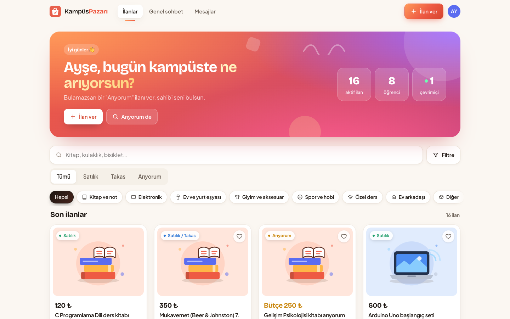
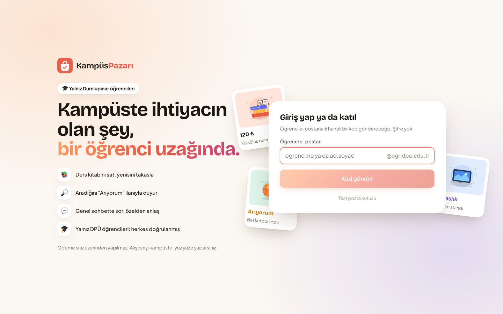
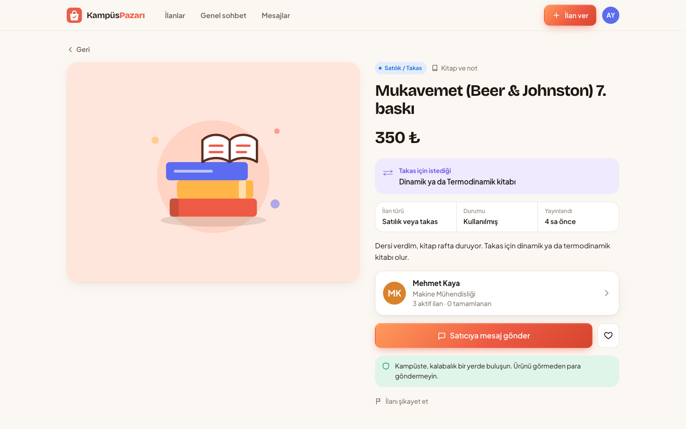
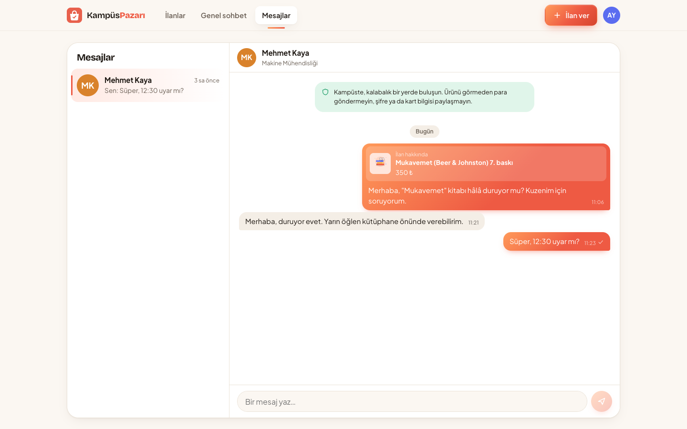
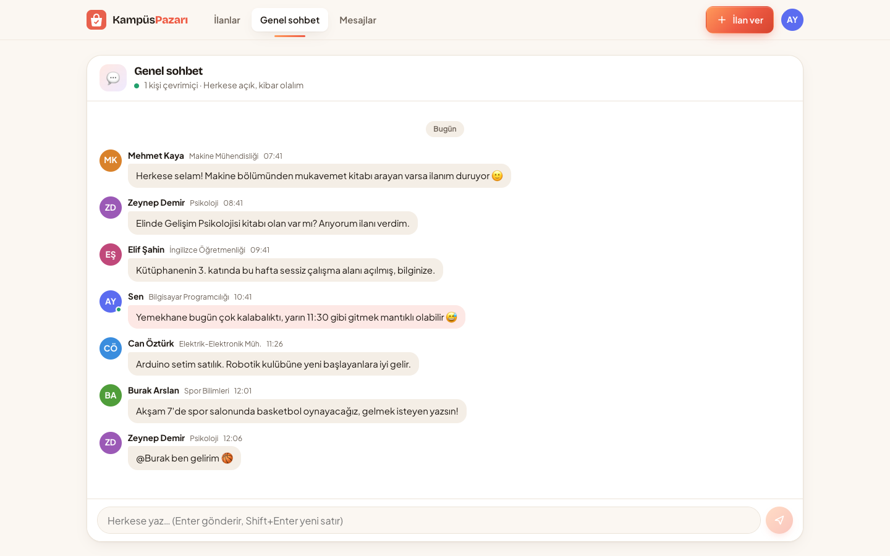
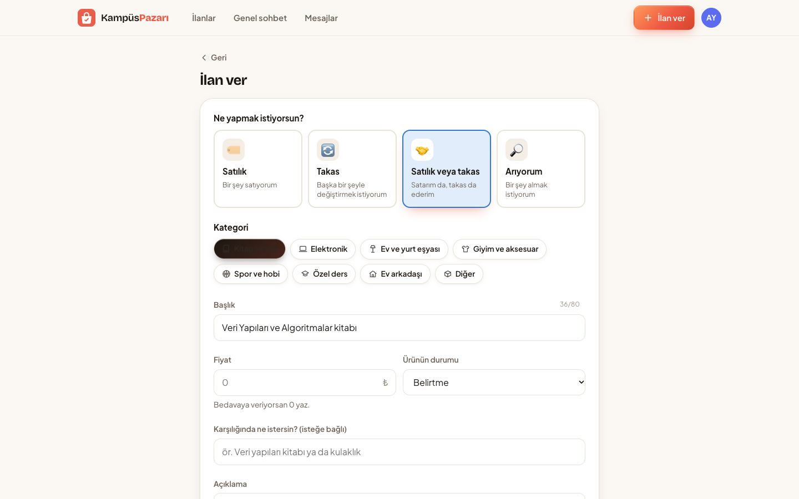
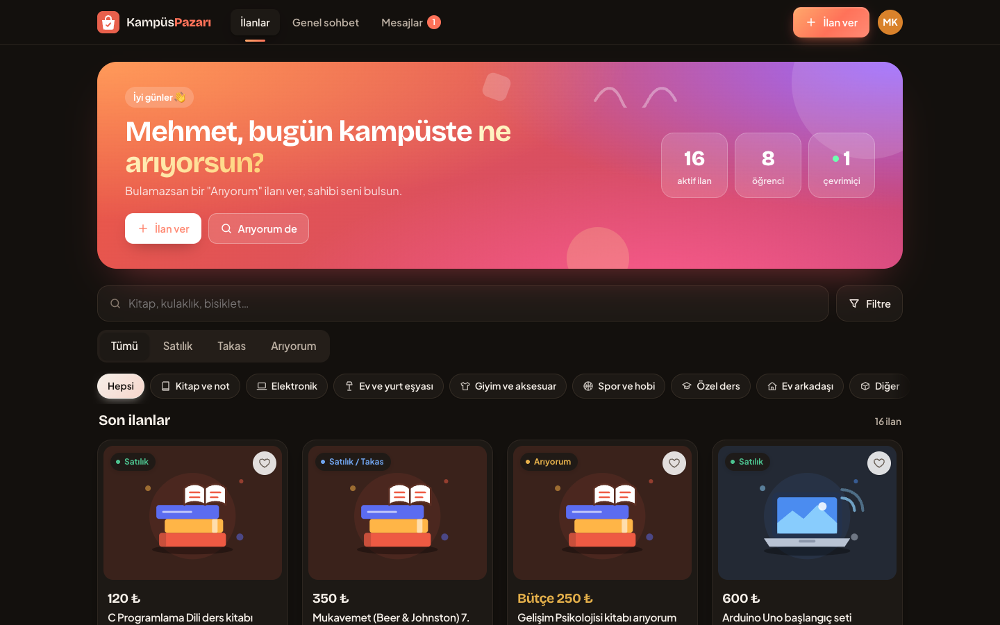
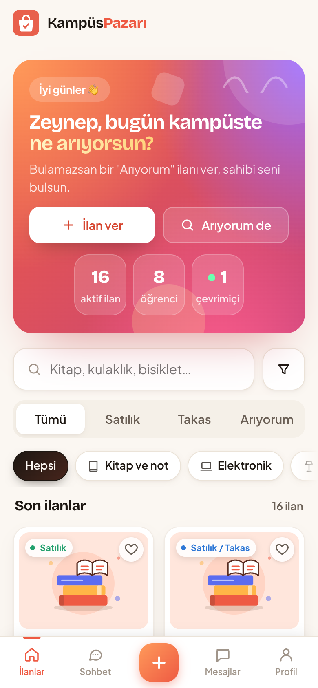
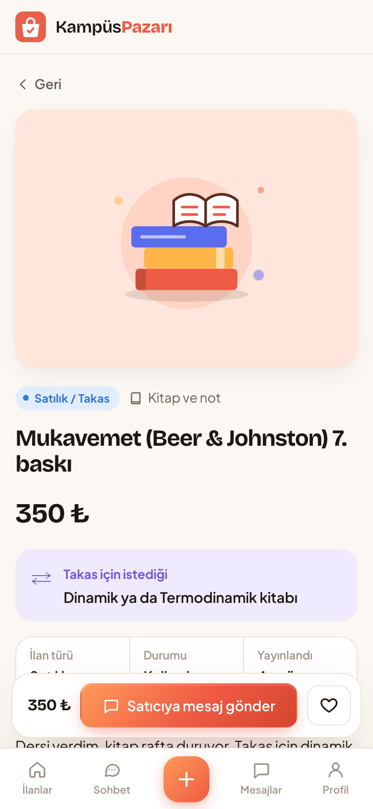
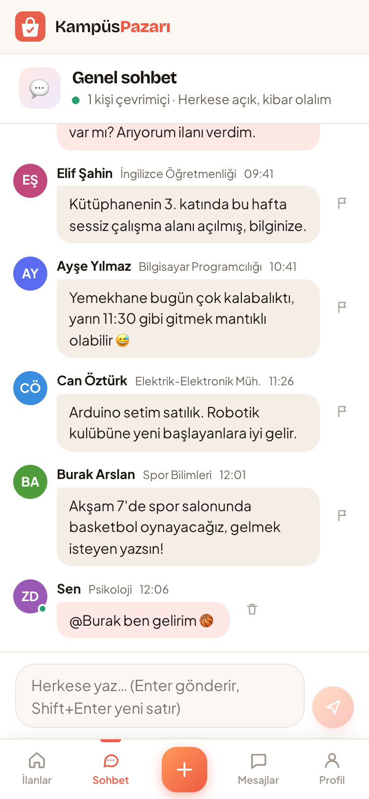

[English](README.md) · **Türkçe**

# Kampüs Pazarı: öğrencilere özel kampüs pazarı

Kütahya Dumlupınar Üniversitesi öğrencilerinin `@ogr.dpu.edu.tr` adresiyle girebildiği bir alım, satım ve takas sitesi. Öğrenciler ilan verir ("satıyorum", "takas", "satılık veya takas", "arıyorum"), birbirleriyle anlık özel mesajlaşır ve herkese açık kampüs sohbetinde konuşur. Sitede ödeme yoktur: alışveriş kampüste, yüz yüze yapılır.

> Bilgisayarda çalışan bir öğrenme ve portföy projesidir. Yayında değildir, üniversitenin resmî bir hizmeti değildir.

## Ekran görüntüleri



| Giriş | İlan detayı | Özel mesajlar |
|---|---|---|
|  |  |  |

| Kampüs sohbeti | İlan verme | Koyu tema |
|---|---|---|
|  |  |  |

**Telefonda:**

<p>
  
  
  
</p>

## Özellikler

- **Yalnız öğrenci girişi:** öğrenci e-postasına 6 haneli kod gelir, şifre yoktur. Alan adı kontrolü sunucuda yapılır. Kodlar özet (hash) olarak saklanır, 10 dakika geçerlidir ve 5 deneme hakkı vardır; yeni kod isteği hız sınırlıdır.
- **İlanlar:** 4 ilan türü, 8 kategori, ilan başına en çok 5 fotoğraf (tarayıcıda küçültülür, sunucu dosya türünü baytlarından doğrular), ürün durumu, fiyat ya da bütçe, takas isteği.
- **Arama ve filtre:** Türkçe harflere duyarlı arama; tür, kategori ve fiyat aralığı filtreleri; sıralama. Filtreler adres çubuğunda tutulur.
- **Anlık sohbet (WebSocket):** herkese açık kampüs odası ve birebir özel sohbetler. Çevrimiçi durumu, okunmamış sayacı, okundu bilgisi var; mesaja ilan kartı eklenebilir.
- **Güvenlik:** engelleme (iki yönlü çalışır: mesaj atılamaz, ilanlar görünmez); ilan, kişi ve mesaj şikayeti; ilan kaldırma, mesaj silme ve hesap kapatma için yönetici paneli. Yönetici bir hesabı kapatınca o hesabın oturumu hemen sonlanır.
- **Temel güvenlik önlemleri:** httpOnly ve SameSite çerez (veritabanında yalnız oturum anahtarının özeti tutulur), her yazma isteğinde Origin kontrolü ve yalnız JSON kabulü, kişi başına mesaj hız sınırı.
- **Telefona uyumlu:** masaüstünde üst menü, telefonda alt sekme çubuğu, telefonda tam ekran sohbet, otomatik koyu tema.
- **Test posta kutusu:** gerçek e-posta gönderilmez; giriş kodları `/posta` sayfasına ve sunucu terminaline düşer.

## Kullanılan teknolojiler

| Parça | Araçlar |
|---|---|
| Arayüz | React 19, TypeScript, React Router, Vite |
| Sunucu | Node.js (TypeScript'i doğrudan çalıştırır), Express 5, `ws` |
| Veritabanı | Node'un yerleşik `node:sqlite` modülüyle SQLite (11 tablo, yabancı anahtarlar, işlemler) |
| Testler | `node:test`: geçici veritabanına gerçek HTTP istekleri gönderen 17 test |

## Çalıştırma

Node.js 24 ya da daha yeni bir sürüm gerekir.

```bash
npm install
npm run build
npm run demo     # örnek öğrenciler, ilanlar ve mesajlar
npm start        # http://127.0.0.1:8776
```

Mac'te bunun yerine `Kampüs Pazarı.command` dosyasına çift tıklaman yeter.

- Anında yenilenen geliştirme modu: `npm run dev`
- Testler: `npm test` · Tür denetimi: `npm run check`
- Demo hesaplar: giriş sayfasına `ayse.yilmaz` ya da `mehmet.kaya` yaz, kodu **Test posta kutusu**ndan al. Yönetici hesabı `yonetici@ogr.dpu.edu.tr`.

## Klasör yapısı

```
ortak/      sunucu ve arayüzün ortak sabitleri
sunucu/     API (uygulama.ts), giriş, WebSocket, fotoğraf, veritabanı, demo veri
istemci/    React arayüzü (sayfalar src/sayfalar altında)
test/       API testleri
veri/       SQLite veritabanı ve fotoğraflar (çalışınca oluşur, git'e girmez)
```
